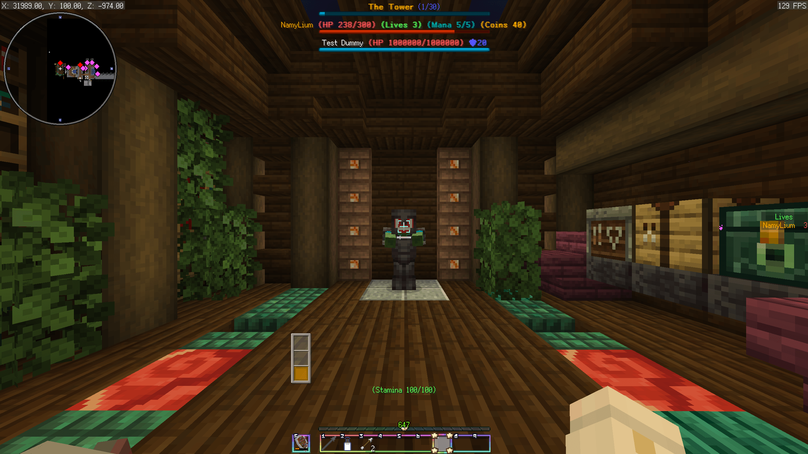
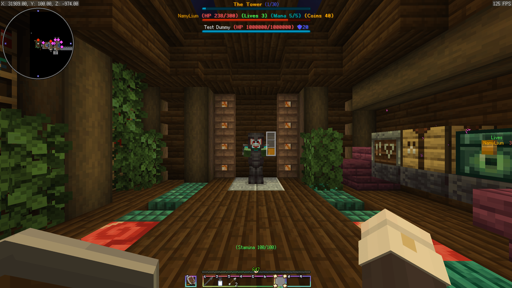

# CTT Shield Indicator (Minecraft 1.21.4 client mod)

[](https://github.com/nyaLium/ctt-shield-indicator/actions/workflows/build.yml)
[](LICENSE)

**English** · [中文](README.zh-CN.md) · [Changelog](CHANGELOG.md) · [Publishing](docs/publishing.md) · [Source](https://github.com/nyaLium/ctt-shield-indicator) · [Releases](https://github.com/nyaLium/ctt-shield-indicator/releases) · [Issues](https://github.com/nyaLium/ctt-shield-indicator/issues)

| Requirement | Version |
| --- | --- |
| Minecraft | 1.21.4 |
| Loader | Fabric Loader 0.16.9+ / Fabric API 0.119.4+1.21.4 |
| Mod Menu (optional) | 13.0.0+ — only needed for the in-game settings screen |
| Environment | Client only (`"environment": "client"`) |
| Java | 21 |

> This is the **`1.21.4` branch** of the project; `main` tracks the Minecraft 26.3 build.
> Feature set and config format are identical — only the build target and the HUD hook differ.

## Features

- When the **offhand** item's `minecraft:custom_data` contains `shield:1b` or `shieldAbility:1b`,
  a shield cooldown bar is drawn **directly above** the offhand slot.
- Offhand only — the same item in the main hand / hotbar / inventory never triggers it.
- **Hidden at full durability.**
- **Your choice of position** — anchor the gauge above the offhand slot (default) or at the **centre of
  the screen**, then nudge it left or right by up to 160 px. Each position remembers its own size and
  offset, so switching back and forth never loses your tuning.
- **Adjustable opacity** — fade the gauge back if you want it to stay out of the way.
- All settings can be changed **in-game through Mod Menu** (Mods → CTT Shield Indicator → Configure),
  or by editing the config file.

| damage / max_damage | Shown |
| --- | --- |
| 0 (full durability) | nothing |
| 0 &lt; r &lt; 0.4 | `meter_3` (3 cells) |
| 0.4 ≤ r &lt; 0.6 | `meter_2` (2 cells) |
| 0.6 ≤ r &lt; 0.8 | `meter_1` (1 cell) |
| ≥ 0.8 | `meter_0` (0 cells) |

## Placement

- Horizontal anchor is the offhand **item cell**: vanilla draws the 16×16 item at
  `guiWidth/2-117` (left) / `guiWidth/2+101` (right), so the centres are `center∓109`.
  (The 29-wide frame sprite starts at `center-120`; its centre `center∓105.5` would be 3.5 px off.)
- With `position: "center"` the gauge is placed in the middle of the whole HUD (both axes, not above
  the actionbar) and `gapAboveActionBar` no longer applies. Either anchor is then shifted by that
  position's `offset` and clamped so the whole gauge stays on screen.
- The actionbar text is drawn after `translate(0, guiHeight-68)` at local `y=-4`,
  so its top edge is ≈ `guiHeight-72`.
- The gauge bottom sits at `guiHeight - 72 - gapAboveActionBar` (default 2 px), so it floats just
  above the actionbar — never covered by the text, never covering it.




## Building

Requires JDK 21. A Gradle wrapper (9.9.1) is included:

```bash
./gradlew build
```

## Installation

1. Fabric Loader 0.16.9+ and Fabric API 0.119.4+1.21.4 (client side).
2. Drop the jar into `.minecraft/mods`.

## Configuration

Generated on first launch at `config/ctt_shield_indicator.json`.
With **Mod Menu** installed everything below is also editable in-game
(Mods → CTT Shield Indicator → Configure), including a "Reset to defaults" button.

```json
{
  "enabled": true,
  "position": "offhand",
  "opacity": 1.0,
  "gapAboveActionBar": 2,
  "offhand": { "scale": 1.1, "offset": 0 },
  "center": { "scale": 0.85, "offset": 25 }
}
```

| Key | Meaning |
| --- | --- |
| `enabled` | Master switch. When false nothing is drawn. |
| `position` | `"offhand"` anchors to the offhand slot (default); `"center"` puts the gauge in the middle of the screen. |
| `opacity` | 0.10–1.00, default 1.00. Only affects the gauge itself. |
| `gapAboveActionBar` | Pixels between the gauge bottom and the top of the actionbar text. Only used by `"offhand"`. |
| `offhand` / `center` | Each position keeps its **own** `scale` and `offset`, so switching between them never overwrites the other one's tuning. |

`scale` inside a profile is the gauge width (`20 px × scale`, height follows the texture's 52:128
ratio); `offset` shifts it left/right by up to ±160 px and is clamped so the gauge stays on screen.

In-game (Mod Menu), `position` is a cycle button and the numbers are sliders, so you can tune them
while watching the result. Scale and offset always edit the position you are currently using.

Changes take effect after re-entering the world or restarting the game.

## Project layout

```
src/main/java/com/nyalium/cttshieldindicator/
    CttShieldIndicatorClient.java   entrypoint, registers the HUD render callback
    ShieldIndicatorHud.java         conditions + drawing
    ShieldIndicatorConfig.java      config/ctt_shield_indicator.json (load/save/reset)
    ModMenuIntegration.java         Mod Menu entrypoint (optional dependency)
    ShieldIndicatorConfigScreen.java  in-game settings screen
src/main/resources/
    fabric.mod.json
    assets/ctt_shield_indicator/    gauge textures, icon, en_us/zh_cn lang
docs/                               layout preview, publishing guide
```

## Links

- Source / Issues — https://github.com/nyaLium/ctt-shield-indicator
- Releases (download the jar) — https://github.com/nyaLium/ctt-shield-indicator/releases
- Changelog — [CHANGELOG.md](CHANGELOG.md)
- Publishing notes — [docs/publishing.md](docs/publishing.md)

## License

MIT — see [LICENSE](LICENSE).
