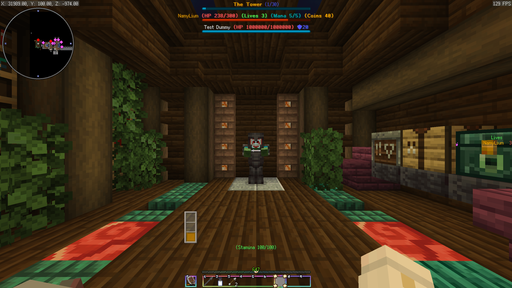
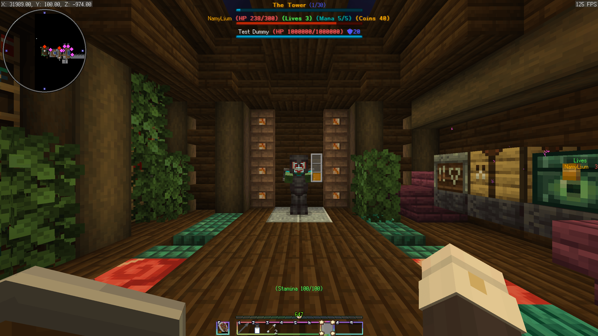

# CTT Shield Indicator（1.21.4 客户端 Mod）

[](https://github.com/nyaLium/ctt-shield-indicator/actions/workflows/build.yml)
[](LICENSE)

[English](README.md) · **中文** · [更新日志](CHANGELOG.md) · [发布说明](docs/publishing.md) · [源码](https://github.com/nyaLium/ctt-shield-indicator) · [下载](https://github.com/nyaLium/ctt-shield-indicator/releases) · [Issues](https://github.com/nyaLium/ctt-shield-indicator/issues)

| 项目 | 值 |
| --- | --- |
| Minecraft | 1.21.4 |
| 加载器 | Fabric Loader 0.16.9+ / Fabric API 0.119.4+1.21.4 |
| Mod Menu（可选） | 13.0.0+，只有游戏内设置界面需要 |
| 环境 | 纯客户端（`"environment": "client"`） |
| Java | 21 |

> 这是本项目的 **`1.21.4` 分支**，`main` 分支对应 Minecraft 26.3 版本。
> 功能与配置格式完全一致，只有构建目标和 HUD 挂载方式不同。

## 功能

- **副手**物品的 `minecraft:custom_data` 中 `shield:1b` 或 `shieldAbility:1b` 为真时，在副手槽位
  **正上方**显示盾牌冷却条。
- 只在副手显示；主手 / 快捷栏 / 背包中的同一物品不会触发。
- **耐久满时不显示**
- **位置可选**：指示条可以对齐副手槽（默认），也可以放到**屏幕中心**，再左右平移 ±160 像素微调。
  两个位置各记一套尺寸与偏移，来回切换不会互相覆盖。
- **透明度可调**：想让它在画面上更淡一点也可以。
- 所有设置都可以**在游戏内通过 Mod Menu 修改**（模组 → CTT Shield Indicator → 配置），也可以直接改配置文件。

| damage / max_damage | 显示 |
| --- | --- |
| 0（耐久满） | 不显示 |
| 0 &lt; r &lt; 0.4 | `meter_3`（3 格） |
| 0.4 ≤ r &lt; 0.6 | `meter_2`（2 格） |
| 0.6 ≤ r &lt; 0.8 | `meter_1`（1 格） |
| ≥ 0.8 | `meter_0`（0 格） |

## 位置

- 水平方向对齐的是副手**物品格**：原版把 16×16 的物品画在 `guiWidth/2-117`（左）/ `guiWidth/2+101`（右），
  所以物品格中心是 `center∓109`。（29 宽的外框 sprite 从 `center-120` 开始，它的中心 `center∓105.5`
  会偏 3.5px。）
- 把 `position` 设为 `"center"` 时，指示器放在整个界面的正中（水平、垂直都居中，不是 actionbar 上方），
  此时间距配置不生效；无论哪种模式，都会再叠加该位置的 `offset`，并保证整条指示器留在屏幕内。
- actionbar 文本画在 `translate(0, guiHeight-68)` 之后、本地 `y=-4` 处 → 文本顶边 ≈ `guiHeight-72`。
- 指示器底端 = `guiHeight - 72 - gapAboveActionBar`（默认 2px），所以它悬在 actionbar 上方，
  既不会被 actionbar 文字盖住，也不遮挡文字。




## 构建

需要 JDK 21。仓库带 Gradle wrapper（9.9.1）：

```bash
./gradlew build
```

## 安装

1. Fabric Loader 0.16.9+ 与 Fabric API 0.119.4+1.21.4（客户端）。
2. jar 放进 `.minecraft/mods`。

## 配置

首次启动生成 `config/ctt_shield_indicator.json`。装了 **Mod Menu** 的话，下面这些都能在游戏内改
（模组 → CTT Shield Indicator → 配置），界面上还有「恢复默认」按钮。

```json
{
  "enabled": true,
  "position": "offhand",
  "opacity": 1.0,
  "gapAboveActionBar": 2,
  "offhand": { "scale": 1.1, "offset": 0 },
  "center": { "scale": 0.85, "offset": 25 }
}
```

| 字段 | 说明 |
| --- | --- |
| `enabled` | 总开关，关掉后什么都不画 |
| `position` | `"offhand"` 对齐副手槽（默认）；`"center"` 放在整个界面正中 |
| `opacity` | 透明度 0.10–1.00，默认 1.00，只影响指示条本身 |
| `gapAboveActionBar` | 底端与 actionbar 文字顶部的间距（像素），仅 `"offhand"` 模式使用 |
| `offhand` / `center` | 两个位置各自的 `scale` 与 `offset`，互不干扰 |

`scale` 是宽度（一格 20px × 本值，高度按纹理 52:128 自动），`offset` 是左右偏移像素（±160，
超出屏幕会被拉回）。

游戏内（Mod Menu）里「位置」是循环按钮，其余数值都是滑块，可以边看效果边拖；
缩放与偏移改的始终是**当前正在用的那个位置**。

改完保存后重新进入世界/重开游戏生效。

## 目录结构

```
src/main/java/com/nyalium/cttshieldindicator/
    CttShieldIndicatorClient.java   入口，注册 HUD 渲染回调
    ShieldIndicatorHud.java         判定 + 绘制
    ShieldIndicatorConfig.java      config/ctt_shield_indicator.json（读/写/恢复默认）
    ModMenuIntegration.java         Mod Menu 入口点（可选依赖）
    ShieldIndicatorConfigScreen.java  游戏内设置界面
src/main/resources/
    fabric.mod.json
    assets/ctt_shield_indicator/    计量条纹理、图标、en_us/zh_cn 语言文件
docs/                               布局示意图、发布说明
```

## 相关链接

- 源码 / 问题反馈 — https://github.com/nyaLium/ctt-shield-indicator
- 下载（Releases） — https://github.com/nyaLium/ctt-shield-indicator/releases
- 更新日志 — [CHANGELOG.md](CHANGELOG.md)
- 发布说明 — [docs/publishing.md](docs/publishing.md)

## 许可证

MIT，见 [LICENSE](LICENSE)。
