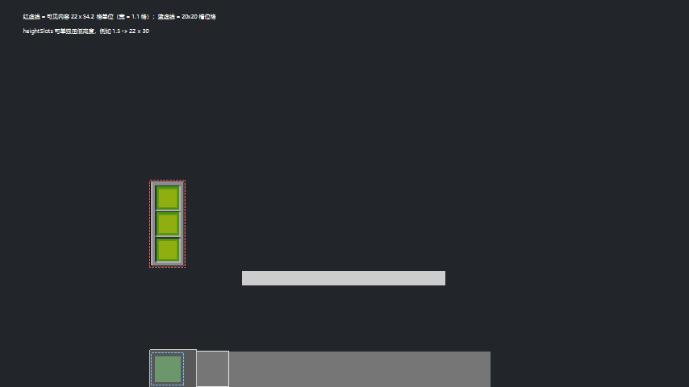

# CTT Shield Indicator

A **client-side** Fabric mod for Minecraft 26.3 that draws a shield durability gauge above the
offhand slot. No server-side datapack or mod is required.

This is the client-mod rewrite of the `CTT Shield Enhancing` datapack: instead of swapping
`minecraft:item_model` components (which requires the server), the client reads the item's
`custom_data` and its damage value and draws the gauge itself.

## How it works

Shown when **all** of the following are true:

1. the offhand item's `minecraft:custom_data` contains `shield:1b` or `shieldAbility:1b`;
2. the item is damageable (`max_damage > 0`) and not at full durability (`damage > 0`);
3. the item is actually in the offhand (main hand / hotbar / inventory never trigger it).

Gauge tiers follow the datapack's `range_dispatch` thresholds
(`RangeSelectItemModel` picks the last entry whose threshold is `<=` the value):

| damage / max_damage | texture |
| --- | --- |
| >= 0.8 | `meter_0` (0 cells) |
| >= 0.6 | `meter_1` (1 cell) |
| >= 0.4 | `meter_2` (2 cells) |
| < 0.4 | `meter_3` (3 cells) |

Because the shield icon is no longer drawn, the datapack's `0 < r < 0.2` tier ("shield only, no meter")
is merged into `meter_3`, so the gauge appears as soon as durability is not full.

## Placement & size

- Anchored bottom-up: the gauge bottom sits `gapAboveActionBar` pixels above the actionbar text top
  (`guiHeight - 72`), so the two never overlap.
- Horizontally centered on the offhand **item cell**: vanilla draws the 16×16 item at `center-117`
  (left) / `center+101` (right), i.e. centers `center∓109` — not the 29-wide frame center `center∓105.5`.
- Sized by the **visible content** of the texture (`52×128` inside a 136×136 canvas):
  `width = 20px (one slot cell) × widthSlots`, height follows the 52:128 ratio unless `heightSlots` is set.



## Requirements

- Minecraft 26.3
- Fabric Loader 0.20.1+
- Fabric API 0.166.2+26.3
- Java 25

## Build

```bash
./gradlew build
```

Output: `build/libs/ctt_shield_indicator-1.0.0.jar`

> Since 26.x the Minecraft client ships unobfuscated, so this project uses Loom's **no-remap** mode
> (`id 'net.fabricmc.fabric-loom'`) and needs no `mappings` dependency.

## Configuration

Generated on first launch at `config/ctt_shield_indicator.json`:

```json
{
  "enabled": true,
  "showMeter": true,
  "widthSlots": 1.1,
  "heightSlots": 0.0,
  "gapAboveActionBar": 2,
  "meterMode": "texture"
}
```

| key | meaning |
| --- | --- |
| `enabled` | master switch |
| `showMeter` | hide the whole indicator when false |
| `widthSlots` | visible content width = 20px × value (`1.0` = one slot wide, `1.1` slightly wider) |
| `heightSlots` | visible content height; `0` = follow the 52:128 ratio |
| `gapAboveActionBar` | pixels between the gauge bottom and the actionbar text top |
| `meterMode` | `texture` (default) or `model` (renders the pack's `meter_N` model instead) |

## License

MIT — see [LICENSE](LICENSE).
