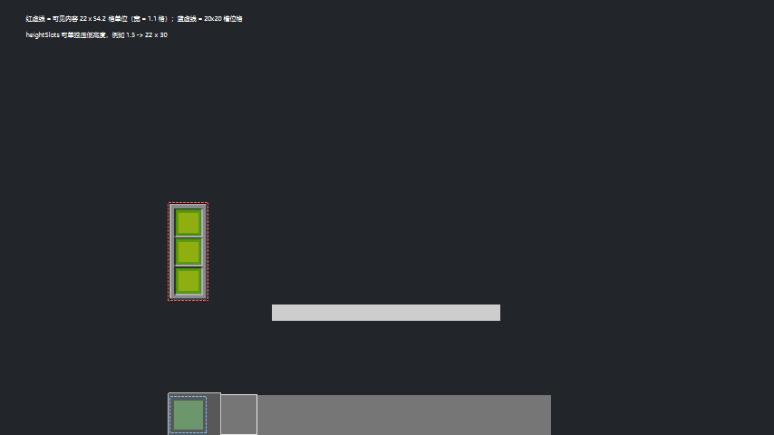

# CTT Shield Indicator

Client-side shield durability gauge for the **offhand slot** — Minecraft 26.3 / Fabric.



## What it does

When the **offhand** item's `minecraft:custom_data` contains `shield:1b` or `shieldAbility:1b`,
a durability gauge is drawn **directly above the offhand slot**.

- **Offhand only** — the same item in the main hand, hotbar or inventory never triggers it.
- **Hidden at full durability.**
- **Nothing is required on the server.** This is a plain client mod: it reads the item components
  and the damage value locally, so it works in singleplayer and on any server, vanilla included.

This is the client-mod rewrite of the `CTT Shield Enhancing` datapack. The datapack swapped
`minecraft:item_model` components, which forced every server to install it; this mod draws the
gauge itself instead, so the server does not need to know about it.

## How much durability is left

| Damage / max damage | Gauge |
| --- | --- |
| 0 (full) | hidden |
| 0 < r < 0.4 | 3 cells |
| 0.4 ≤ r < 0.6 | 2 cells |
| 0.6 ≤ r < 0.8 | 1 cell |
| ≥ 0.8 | 0 cells |

The thresholds mirror the datapack's `range_dispatch` model, so the gauge keeps the same meaning —
it is just no longer tied to the item model.

## Placement

- Horizontally centred on the offhand **item cell** (`guiWidth/2 ∓ 109`), not on the 29 px frame,
  so it lines up with the item itself.
- The bottom edge sits `gapAboveActionBar` pixels above the actionbar text: it never covers the
  text and is never covered by it.

## Settings

Everything is configurable, either in game (needs **Mod Menu**: Mods → CTT Shield Indicator →
Configure, with a "Reset to defaults" button) or in `config/ctt_shield_indicator.json`:

```json
{
  "enabled": true,
  "scale": 1.1,
  "gapAboveActionBar": 2
}
```

| Key | Meaning |
| --- | --- |
| `enabled` | Master switch. When false nothing is drawn. |
| `scale` | Gauge width, in slot cells: `20 px × scale`. `1.0` = exactly one slot wide, `1.1` slightly wider (default). Height always follows the texture's 52:128 ratio. |
| `gapAboveActionBar` | Pixels between the gauge bottom and the top of the actionbar text. |

In game both numbers are sliders, so they can be tuned while watching the result.

## Requirements

- Minecraft **26.3**
- **Fabric Loader 0.20.1+**
- **Fabric API 0.166.2+26.3**
- **Java 25**
- **Mod Menu 21.0.0+** — optional, only for the in-game settings screen

## Installation

1. Install Fabric Loader 0.20.1+ for Minecraft 26.3.
2. Put **Fabric API** and this jar into `.minecraft/mods`.
3. Launch. Optionally add **Mod Menu** to change the settings in game.

Client only — do not install it on the server.

## Notes

- Meant to be used together with the CTT resource pack: the shield textures come from it, this mod
  only draws the gauge.
- MIT licensed, source on [GitHub](https://github.com/nyaLium/ctt-shield-indicator).
- Issues and suggestions: [issue tracker](https://github.com/nyaLium/ctt-shield-indicator/issues).

---

# 中文说明

**纯客户端**的副手盾牌耐久计量条，适配 Minecraft 26.3 / Fabric。


## 作用

当**副手**物品的 `minecraft:custom_data` 含有 `shield:1b` 或 `shieldAbility:1b` 时，
在副手槽**正上方**显示一个耐久计量条。

- **只在副手显示**：同样的物品放在主手、快捷栏或背包里都不会触发。
- **耐久满时不显示。**
- **服务端什么都不用装。** 这是纯客户端 Mod：组件和耐久都在本地读取，单人、多人、
  任何服务器（包括原版服）都能用。

这是 `CTT Shield Enhancing` 数据包的客户端重写版。数据包靠替换 `minecraft:item_model` 实现，
因此要求服务端必须安装；这个 Mod 改成自己绘制，服务端完全不需要知道它的存在。

## 剩余耐久显示

| 耐久损失比例 | 计量条 |
| --- | --- |
| 0（满耐久） | 不显示 |
| 0 < r < 0.4 | 3 格 |
| 0.4 ≤ r < 0.6 | 2 格 |
| 0.6 ≤ r < 0.8 | 1 格 |
| ≥ 0.8 | 0 格 |

阈值与数据包 `range_dispatch` 模型一致，含义不变，只是不再绑定到物品模型。

## 位置

- 水平方向对齐副手**物品格**中心（`guiWidth/2 ∓ 109`），不是 29 px 外框的中心。
- 底边位于 actionbar 文字上方 `gapAboveActionBar` 像素处，不遮挡也不被遮挡。

## 配置

可以直接改文件，也可以装 **Mod Menu** 后在游戏内「模组 → CTT Shield Indicator → 配置」里调
（带「恢复默认」按钮）：

```json
{
  "enabled": true,
  "scale": 1.1,
  "gapAboveActionBar": 2
}
```

| 键 | 含义 |
| --- | --- |
| `enabled` | 总开关。为 false 时不绘制。 |
| `scale` | 计量条宽度，单位是槽位格：`20 px × scale`。`1.0` = 正好一格宽，`1.1` 略宽（默认）。高度始终按纹理 52:128 的固定比例。 |
| `gapAboveActionBar` | 计量条底边与 actionbar 文字顶边的像素间距。 |

游戏内这两项都是滑块，可以边看效果边调。

## 前置

- Minecraft **26.3**
- **Fabric Loader 0.20.1+**
- **Fabric API 0.166.2+26.3**
- **Java 25**
- **Mod Menu 21.0.0+** —— 可选，仅用于游戏内设置界面

## 安装

1. 为 Minecraft 26.3 安装 Fabric Loader 0.20.1+。
2. 把 **Fabric API** 和本 jar 放进 `.minecraft/mods`。
3. 启动即可。需要改设置的话再装 **Mod Menu**。

纯客户端，不要装到服务端。

## 说明

- 建议与 CTT 资源包一起用：盾牌贴图由资源包提供，本 Mod 只负责画计量条。
- MIT 许可证，源码在 [GitHub](https://github.com/nyaLium/ctt-shield-indicator)。
- 问题反馈：[issue tracker](https://github.com/nyaLium/ctt-shield-indicator/issues)。
